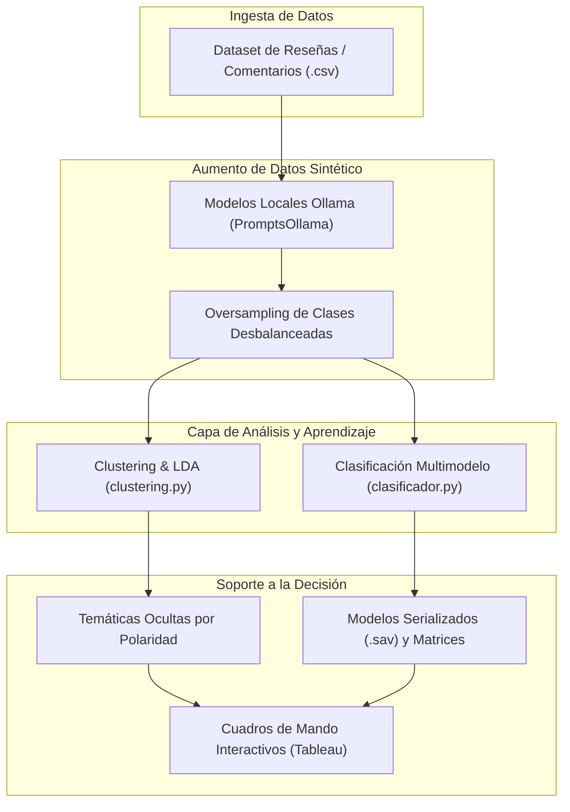

# Sistema de Apoyo a la Decisión (DSS) mediante Machine Learning e IA Generativa

<p align="left">
  
  
  
  
  
  
</p>

Plataforma de soporte a la toma de decisiones empresariales (*Decision Support System*) basada en análisis de texto, minería de opiniones y modelado predictivo. El proyecto combina algoritmos de aprendizaje no supervisado (Topic Modeling mediante Latent Dirichlet Allocation), clasificación supervisada multimodelo, técnicas de aumento sintético de datos con modelos de lenguaje locales (Ollama) y tableros interactivos de inteligencia de negocio en Tableau.

Desarrollado para la asignatura Sistemas de Apoyo a la Decisión (SAD) por el equipo de trabajo Coachella.

---

## Índice
- [Descripción general](#descripción-general)
- [Arquitectura del pipeline](#arquitectura-del-pipeline)
- [Módulos del sistema](#módulos-del-sistema)
- [Estructura del proyecto](#estructura-del-proyecto)
- [Guía de ejecución](#guía-de-ejecución)
- [Equipo y áreas de responsabilidad](#equipo-y-áreas-de-responsabilidad)
- [Documentación y contexto académico](#documentación-y-contexto-académico)

---

## Descripción general

El objetivo del sistema es procesar grandes volúmenes de retroalimentación textual de clientes, identificar patrones ocultos y temáticas emergentes, y clasificar automáticamente el sentimiento para apoyar la toma de decisiones estratégicas.

Aspectos técnicos destacados:
- Modelado de tópicos probabilístico (LDA) segmentado por polaridad de sentimiento (positivo, negativo, neutro) con búsqueda de número de clusters óptimo ($k$).
- Banco de clasificadores supervisados configurables mediante archivos JSON (kNN, Random Forest, Naive Bayes, Regresión Logística y Árboles de Decisión).
- Estrategias de sobremuestreo sintético (*data augmentation*) mediante LLMs locales ejecutados con Ollama para mitigar el desbalanceo de clases en opiniones neutras o minoritarias.
- Integración final con Tableau para la construcción de cuadros de mando ejecutivos orientados a la dirección de negocio.

---

## Arquitectura del pipeline



---

## Módulos del sistema

### 1. Clustering y Modelado de Tópicos (LDA)
Ubicado en `Proyecto/Clustering/`, este módulo realiza el análisis no supervisado de los textos:
- Segmentación previa del corpus por sentimiento objetivo (`positive`, `negative`, `neutral`).
- Extracción de n-gramas configurables y vectorización de texto.
- Implementación de Latent Dirichlet Allocation (LDA) con rango de búsqueda (`k_min`, `k_max`, `step`) para determinar el número óptimo de tópicos latentes.
- Exportación de resultados agrupados a la carpeta `output/`.

### 2. Clasificación Supervisada
Ubicado en `Proyecto/Clasificador/`, ofrece una herramienta por línea de comandos para experimentación sistemática:
- Algoritmos soportados: `kNN`, `decision_tree`, `random_forest`, `naive_bayes` y `logistic_regression`.
- Modos de operación: `train` (con conjuntos de entrenamiento y validación cruzada) y `test` (inferencia sobre nuevas instancias).
- Reportes automáticos: matrices de confusión, curvas ROC, métricas de precisión, recall y F1-Score, y serialización de modelos entrenados en `.sav`.

### 3. Generación Aumentada con LLMs (Ollama)
Ubicado en `Proyecto/PromptsOllama/`:
- Scripts dedicados para mitigar el sesgo hacia clases mayoritarias: `OversamplingEquilibrado.py`, `OversamplingNeutros.py` y `OversamplingPorcentaje.py`.
- Generación de contexto sintético mediante inferencia local sin dependencias de APIs comerciales de pago.

### 4. Inteligencia de Negocio (Tableau)
Consolidación de las métricas obtenidas y generación de visualizaciones estratégicas para la monitorización de KPIs de satisfacción y tópicos críticos de negocio.

---

## Estructura del proyecto

```text
SAD_Proyecto/
├── Proyecto/
│   ├── Clasificador/           # Módulo de aprendizaje supervisado y evaluación
│   │   ├── clasificador.py     # Script ejecutable de entrenamiento y prueba
│   │   ├── config.json         # Plantilla de configuración de experimentos
│   │   └── README.md           # Documentación específica del clasificador
│   ├── Clustering/             # Módulo de modelado no supervisado de tópicos
│   │   ├── clustering.py       # Script principal de clustering y LDA
│   │   ├── clustering.json     # Configuración de parámetros y sentimiento
│   │   └── README.md           # Documentación específica del clustering
│   ├── PromptsOllama/          # Scripts de data augmentation con LLMs locales
│   │   ├── ClasificadorOllama.py
│   │   └── Oversampling*.py
│   ├── Datos/                  # Conjuntos de datos y particiones de trabajo
│   └── PosterProyecto.pdf      # Póster explicativo del proyecto y resultados
├── Enunciado.pdf               # Requisitos y alcance del proyecto académico
├── requirements.txt            # Dependencias del entorno Python
└── README.md
```

---

## Guía de ejecución

### Requisitos previos
- Python 3.12 instalado.
- Dependencias base instaladas mediante:
  ```bash
  pip install -r requirements.txt
  ```

### Ejecución del módulo de Clustering (LDA)
Desde el directorio `Proyecto/Clustering`:
```bash
python clustering.py -j clustering.json
```
Los parámetros del archivo JSON permiten definir la columna de texto, la polaridad a evaluar y el rango de tópicos a explorar.

### Ejecución del Clasificador Supervisado
Desde el directorio `Proyecto/Clasificador`:
- Modo entrenamiento (`train`):
  ```bash
  python clasificador.py -j config.json -m train -v
  ```
- Modo inferencia / prueba (`test`):
  ```bash
  python clasificador.py -j config.json -m test
  ```

---

## Equipo y áreas de responsabilidad

Proyecto desarrollado por el grupo de trabajo **Coachella**:

- **[Iván Herrera Álvarez](https://github.com/28ivan)** — Líder del módulo de Clustering y Modelado de Tópicos (LDA).
- Iker Fernández Molano — Líder del módulo de Clasificación Supervisada.
- Andre Almaraz Reyes — Líder del módulo de IA Generativa y LLMs (Ollama).
- Mariana García Alanís — Líder del módulo de Cuadros de Mando y Business Intelligence (Tableau).

---

## Documentación y contexto académico

- La síntesis visual y los resultados clave del proyecto se encuentran documentados en el archivo [PosterProyecto.pdf](Proyecto/PosterProyecto.pdf).
- Proyecto realizado para la asignatura de **Sistemas de Apoyo a la Decisión (SAD)** dentro del **Grado en Ingeniería Informática de Gestión y Sistemas de Información** en la **Universidad del País Vasco (UPV/EHU)**.
